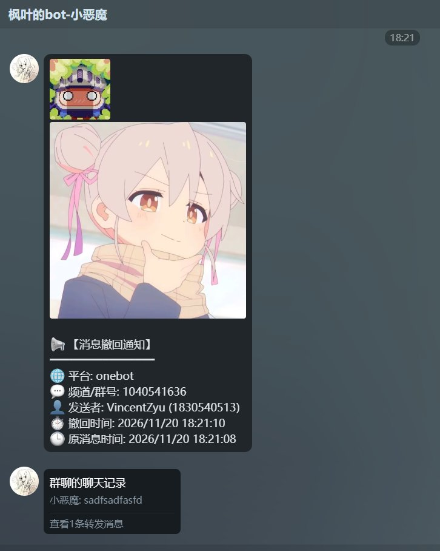

# koishi-plugin-recall-report

基于 Satori 协议的标准全平台消息撤回监听与自适应审计报告插件。

  

---

## ✨ 核心特性

- **🌐 全平台原生支持**：基于 Satori 标准 `message` 与 `message-deleted` 事件驱动，原生兼容 OneBot (QQ)、Discord、KOOK (开黑啦)、Matrix、飞书 (Lark) 等接入平台。
- **🧩 智能自适应渲染**：
  - **QQ / OneBot**：继续保留精巧优雅的“合并转发卡片”；
  - **Discord / KOOK / 其它平台**：自适应降级为“标准 Markdown 引用与富文本”，避免协议不支持报错。
- **🖼️ 跨平台头像标准化**：优先读取 Satori Universal 规范的 CDN 头像，兼顾 OneBot 历史回退。
- **🛡️ 复合命名空间存储**：基于 `${platform}:${channelId}:${messageId}` 严格隔离，多平台多 Bot 并行绝不撞车，内置 LRU 队列与 TTL 自动释放机制。

---

## 📸 效果展示

  

---

## 📦 安装与启用

在 Koishi 控制台插件市场搜索 `recall-report` 并安装启用。

---

## ⚙️ 配置说明

1. **👑 主人账号配置 (`masterAccounts`)**：设置接收审计报告的私聊主人账号（包含目标平台与用户 ID）。
2. **📋 监听目标配置 (`groupConfigs`)**：设置开启撤回监听的群号或频道 ID，平台字段留空即通配所有平台。
3. **⚙️ 缓存与渲染设置**：自定义消息保存时长与最大条数上限，支持开启/关闭合并转发。

---

## 🔧 指令列表

| 指令 | 说明 |
| :--- | :--- |
| `recall-status` | 📊 查看全平台撤回监听状态与已缓存消息统计 |
| `recall-test` | 🧪 在当前群组或频道快速测试配置是否生效 |
| `recall-clear` | 🧹 手动清空当前内存中的所有消息缓存 |

---

## 📄 开源许可证

本项目基于 [MIT License](LICENSE) 开源。
